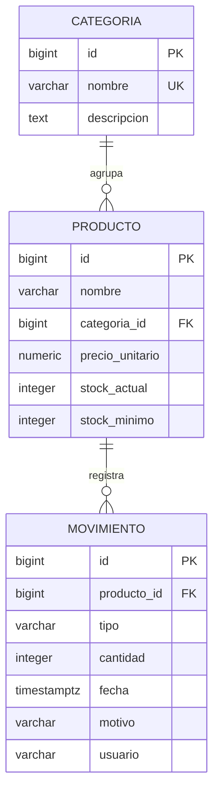

# Sistema de Gestión de Inventario

Resolución del ejercicio de evaluación técnica para Desarrollador Junior — Full Stack. El sistema permite consultar productos con su stock, registrar movimientos de entrada y salida, y alertar cuando un producto tiene stock bajo.

## Stack

- **Backend:** Java 25, Spring Boot, Spring Data JPA (Hibernate), Flyway, Lombok, Maven
- **Base de datos:** PostgreSQL
- **Frontend:** React con TypeScript, Vite, Recharts

## Estructura del repositorio

```
backend/     API REST en Spring Boot
frontend/    Aplicación React
CLAUDE.md    Reglas del proyecto usadas para la implementación asistida con IA
README.md
```

## Cómo levantar el proyecto

> ⚠️ **BORRADOR:** se completa con los comandos reales al implementar.

**Requisitos:** JDK 25, PostgreSQL y Node.js.

**Base de datos:** crear una base `inventario` en PostgreSQL. Las tablas las crea Flyway al arrancar el backend.

**Backend:**

```bash
cd backend
# definir SPRING_DATASOURCE_URL, SPRING_DATASOURCE_USERNAME y SPRING_DATASOURCE_PASSWORD
./mvnw spring-boot:run -Dspring-boot.run.profiles=dev
```

El perfil `dev` carga datos de prueba.

**Frontend:**

```bash
cd frontend
npm install
npm run dev
```

## Endpoints

| Método | Ruta | Descripción |
|---|---|---|
| `GET` | `/productos` | Lista los productos con su stock. Filtro opcional: `?categoria={id}` |
| `POST` | `/movimientos` | Registra una entrada o una salida de stock |

---

# Decisiones y respuestas

## 1. Base de datos

### 1.1 Diseño del modelo



El script completo está en `backend/src/main/resources/db/migration/V1__esquema_inicial.sql`.

El modelo respeta las tres tablas del enunciado, y las reglas de negocio están garantizadas por la propia base de datos. El stock tiene una restricción que impide valores negativos, la categoría del producto y su precio son obligatorios, y el tipo, la fecha y el usuario de cada movimiento también. El precio se guarda como un decimal exacto (`NUMERIC(12,2)`) y no como punto flotante, porque los montos de dinero necesitan exactitud; se permite el valor 0 para productos sin costo. No se puede borrar una categoría que tiene productos ni un producto que tiene movimientos, para no perder historia. La fecha de cada movimiento la registra la base al guardarlo, así no se puede cargar una fecha falsa. La única columna que agregué respecto del enunciado es `stock_minimo`, que se explica en la sección de alertas.

**Supuestos:** las cantidades se cuentan en unidades enteras; para productos a granel habría que agregar una unidad de medida y cantidades decimales. Todo cambio de stock, incluido el stock inicial, entra como un movimiento. El usuario de cada movimiento se guarda como texto porque el enunciado no pide autenticación; en la sección de seguridad explico cómo evolucionaría.

**¿Qué tipo de base de datos elegirías y por qué?**

Elegiría una base de datos relacional, en particular **PostgreSQL**.

Los datos de este sistema tienen una estructura fija, que no varía entre registros, y están relacionados entre sí: cada producto pertenece a una categoría y cada movimiento pertenece a un producto. Ese tipo de datos es justamente lo que mejor resuelve un modelo relacional.

El motivo principal son las **transacciones**. Cuando se registra un movimiento hay que guardar el movimiento y actualizar el stock del producto, y esas dos operaciones tienen que ocurrir juntas: o se hacen las dos o no se hace ninguna. Si no, el stock quedaría desincronizado con el historial.

Además, la base me permite garantizar las reglas de negocio directamente con restricciones, y no depender solo del código:

- Stock nunca negativo → restricción `CHECK (stock_actual >= 0)`.
- Producto siempre con categoría → clave foránea obligatoria (`NOT NULL`).
- Precio siempre definido → campo `NOT NULL`.
- Movimiento con fecha, tipo y usuario → campos obligatorios.

Así, aunque alguien escriba en la base por fuera de la aplicación, las reglas se siguen cumpliendo.

**¿Usarías un ORM? ¿Qué ventajas y desventajas ves en este caso?**

Sí, usaría JPA con Hibernate, que es el ORM estándar de Spring. La principal ventaja es que las tablas se manejan como clases de Java, y la relación entre producto y categoría queda como un atributo del objeto, lo que evita escribir SQL repetitivo para las operaciones comunes. Además se integra con las transacciones de Spring, que necesito para guardar el movimiento y actualizar el stock en una misma operación, y trabaja con consultas parametrizadas, lo que protege contra inyección SQL.

La desventaja es que oculta el SQL que realmente se ejecuta, y eso puede generar consultas ineficientes sin darse cuenta. Un caso típico en este sistema es el listado de productos con el nombre de su categoría: si la consulta no se arma bien, Hibernate trae los productos y después hace consultas adicionales para traer la categoría de cada uno, lo que se conoce como problema N+1. Se resuelve trayendo todo en una sola consulta con un JOIN. También da menos control en operaciones puntuales, como el descuento de stock, que resuelvo con una consulta escrita a mano para que sea un único UPDATE atómico.

**¿Cómo garantizarías que el stock no quede negativo?**

> ⚠️ **BORRADOR NUEVO — revisar.**

Lo garantizo en tres capas. En la base de datos, una restricción `CHECK` impide que el stock sea negativo y funciona como última defensa, aunque alguien escriba por fuera de la aplicación. En el backend, registrar el movimiento y actualizar el stock se hacen en una misma transacción. Pero la transacción sola no alcanza: dos salidas simultáneas podrían leer el mismo stock y validar las dos contra un valor que ya no es real. Por eso el descuento se hace con un UPDATE condicional, que solo resta si el stock alcanza; la base lo ejecuta de forma atómica, y si no modifica ninguna fila, el servicio rechaza la operación. En el frontend, el formulario valida antes de enviar, pero eso es solo para la experiencia de uso: la garantía está en el backend y en la base.

**¿Cómo conviven estas herramientas dentro del stack?**

Uso Flyway para las migraciones y JPA con Hibernate como ORM, y cada uno tiene una responsabilidad distinta. Flyway es el dueño del esquema: los cambios en la base se escriben como archivos SQL numerados, versionados en Git junto con el código, y se aplican automáticamente al arrancar la aplicación, así la base queda igual en cualquier entorno. Hibernate está configurado para no crear ni modificar tablas, solo valida al arrancar que las entidades coincidan con el esquema.

Dentro de la arquitectura, JPA solo se usa en la capa de repositorios. Los servicios trabajan con los repositorios y definen las transacciones, y los controllers nunca acceden a la base. Para las consultas que el ORM no resuelve bien, como el descuento de stock con un UPDATE condicional o el cálculo del stock histórico, escribo la consulta a mano dentro del repositorio. No usé un cliente SQL directo porque en este sistema no hace falta. Lo usaría para reportes pesados o cargas masivas, donde mapear cada fila a una entidad no aporta nada.

### 1.2 Historial de cambios

**Si alguien edita el nombre o precio de un producto, ¿cómo guardarías el valor anterior? ¿Dónde?**

Lo guardaría en una tabla aparte, `producto_historial`. Cada vez que se edita un producto, se guarda una fila con el nombre y el precio que tenía antes del cambio, quién lo modificó y cuándo. El registro lo escribe la capa de servicio dentro de la misma transacción que la edición, así no puede existir un cambio sin su historial ni al revés.

```sql
CREATE TABLE producto_historial (
    id               BIGINT GENERATED ALWAYS AS IDENTITY PRIMARY KEY,
    producto_id      BIGINT        NOT NULL REFERENCES producto(id) ON DELETE RESTRICT,
    nombre_anterior  VARCHAR(150)  NOT NULL,
    precio_anterior  NUMERIC(12,2) NOT NULL,
    usuario          VARCHAR(100)  NOT NULL,
    fecha            TIMESTAMPTZ   NOT NULL DEFAULT now()
);
```

No lo guardaría en la misma tabla de productos porque solo permitiría conservar el último valor y mezclaría datos actuales con historia. Tampoco en los logs, porque se rotan y no se pueden consultar como dato de negocio.

El stock no pasa por esta tabla: sus cambios ya quedan registrados en la tabla de movimientos.

### 1.3 Si el sistema crece

**¿Cómo lo encarás?**

500.000 productos y miles de movimientos diarios no es un volumen grande para PostgreSQL. El problema no pasa por cuánto se guarda sino por cómo se consulta, así que lo primero sería agregar índices en las columnas por las que se filtra: la categoría del producto, para el listado, y el producto y la fecha del movimiento, para el historial. También paginaría el listado de productos, porque devolver 500.000 registros en una sola respuesta no es manejable ni para el servidor ni para el usuario.

Para el stock histórico, como todo cambio de stock, incluido el inicial, entra como un movimiento, el stock de un producto en cualquier fecha se puede calcular sumando sus entradas y restando sus salidas hasta esa fecha. No requiere cambios en el modelo y, con el índice por producto y fecha, la consulta es rápida. Si con el tiempo el volumen de movimientos hace que ese cálculo sea lento, o se necesita el stock de todos los productos a una fecha, agregaría una tabla con una foto diaria del stock de cada producto, generada por un proceso nocturno; así el cálculo parte de la última foto y solo suma los movimientos posteriores.

## 2. Backend

### 2.1 Decisiones de arquitectura

**¿Qué lenguaje y framework usarías?**

Elegí Java con Spring Boot. El enunciado permite justificar otra elección y preferí usar el stack donde tengo experiencia real, para entregar algo que pueda defender a fondo. Las decisiones de diseño, como la separación en capas, las transacciones o las migraciones, no dependen del lenguaje. Con más tiempo lo haría en Python sin problema, y si es el stack del equipo, es lo próximo que aprendo.

**¿Cómo organizarías el proyecto?**

Organicé el proyecto por capas: controller, service, repository y entity, además de los DTO de respuesta y un manejador global de errores. Cada capa solo conoce a la de abajo. El controller recibe la petición y devuelve JSON sin lógica de negocio, el servicio aplica las reglas y maneja las transacciones, y el repositorio accede a la base. Esta separación permite cambiar una capa sin tocar las demás; por ejemplo, cambiar cómo se consulta la base no afecta a la API. Los DTO separan lo que expone la API del modelo de la base, para que un cambio en una tabla no rompa a quien consume el endpoint.

Para un sistema de este tamaño la organización por capas es la más clara. Si el sistema creciera, pasaría a organizarlo por funcionalidad (productos, movimientos, categorías), cada una con sus propias capas, para que cada parte se pueda mantener de forma independiente.

**¿Dónde configurarías las reglas de negocio?**

Las reglas fijas, como que el stock no puede quedar negativo o los tipos de movimiento válidos, van en el código: en la capa de servicio y en un enum, reforzadas por las restricciones de la base. Los valores que pueden cambiar, como el umbral de stock bajo, van fuera del código para poder ajustarlos sin modificar el sistema. ⚠️ **BORRADOR NUEVO — revisar:** en este caso, cada producto tiene su propio stock mínimo guardado en la base, que se puede cambiar sin tocar el código ni volver a deployar.

### 2.2 Deploy

**¿Cómo deployarías este sistema?**

Deployaría el backend y la base de datos en Railway, y el frontend en Vercel, como ya hice en otro proyecto. En ambas plataformas el deploy se hace conectando el repositorio: cada vez que se integran cambios en la rama principal, la plataforma construye y publica la nueva versión automáticamente. Railway también provee la base PostgreSQL administrada, así no hay que encargarse de servidores, backups ni actualizaciones. Para un sistema de este tamaño es la opción más simple. Si creciera y necesitara más control sobre la infraestructura, empaquetaría la aplicación en una imagen Docker para poder llevarla a cualquier proveedor.

**¿Cómo manejarías las diferencias entre entorno local y producción?**

Con perfiles de Spring: un archivo de configuración común y uno por entorno con lo que cambia, por ejemplo mostrar las consultas SQL solo en local. Los datos sensibles, como la conexión y las credenciales de la base, no están en el repositorio: en local se leen de variables de entorno de mi máquina, y en producción se configuran en Railway. En el frontend pasa lo mismo con la URL de la API, que se define en Vercel. El esquema de la base es el mismo en todos lados porque se crea con las mismas migraciones de Flyway, y en local uso la misma versión de PostgreSQL que en producción.

### 2.3 Seguridad: roles, perfiles y contraseñas

**¿Cómo manejarías los distintos roles? ¿Dónde definirías los permisos?**

Tendría una tabla de usuarios donde cada usuario tiene un rol: administrador, operador de depósito o solo lectura. Qué puede hacer cada rol lo definiría en el código, en la configuración de Spring Security, con todas las reglas en un solo lugar: solo lectura puede consultar, el operador además puede registrar movimientos, y el administrador puede gestionar productos, categorías y usuarios. Con tres roles fijos no hace falta una tabla de permisos. Si los roles tuvieran que configurarse sin modificar el código, ese sería el siguiente paso.

En la implementación actual el usuario del movimiento se guarda como texto, porque el enunciado no pide autenticación. Con este esquema pasaría a ser una referencia a la tabla de usuarios, y se tomaría del usuario autenticado en lugar de completarse a mano.

**¿Qué consideraciones tendrías para el manejo de contraseñas?**

Las contraseñas nunca se guardan en texto plano ni cifradas de forma reversible, sino como un hash con BCrypt, que agrega un valor aleatorio a cada una y es lento a propósito para dificultar los ataques de fuerza bruta. Como política mínima, pediría al menos 8 caracteres y bloquearía temporalmente la cuenta después de varios intentos fallidos. Además, las contraseñas nunca se escriben en los logs y todo el tráfico va por HTTPS.

**¿Cómo protegerías los endpoints según el rol?**

Con autenticación por JWT: al iniciar sesión, el backend devuelve un token firmado que incluye el usuario y su rol, y el frontend lo envía en cada petición. Un filtro de Spring Security valida el token antes de llegar al controller. Si no hay token o no es válido, responde 401; si el rol no tiene permiso para ese endpoint, responde 403. Elegí JWT porque el backend no necesita guardar sesiones y funciona bien con un frontend separado del backend.

### 2.4 Logs del sistema

**¿Qué eventos registrarías en los logs?**

Registraría los errores inesperados con el detalle de la excepción como ERROR; las situaciones anómalas que el sistema manejó, como un movimiento rechazado por stock insuficiente o un login fallido, como WARN; y las acciones relevantes, como un movimiento registrado, un inicio de sesión o el arranque de la aplicación, como INFO. El nivel DEBUG, por ejemplo para ver las consultas SQL, lo usaría solo en local. Nunca registraría contraseñas, tokens ni datos sensibles.

**¿Dónde guardarías esos logs y con qué herramienta?**

Usaría SLF4J con Logback, que es lo que trae Spring Boot, escribiendo en la consola. Railway captura esa salida y permite verla y filtrarla desde su panel, así no hace falta instalar nada más. No usaría archivos locales, porque en Railway se pierden con cada deploy, ni la base de datos, porque los logs generan mucho volumen y no son datos de negocio. Si el sistema creciera y se necesitara buscar en los logs o recibir alertas, los enviaría a un servicio externo como Grafana con Loki.

**¿Cómo diferenciarías los logs de aplicación de la auditoría de negocio?**

La auditoría, que son los movimientos y el historial de cambios de productos, es parte del negocio: se guarda en la base de datos, dentro de la misma transacción que la operación, no se borra nunca y la consultan los usuarios del sistema. Los logs son información técnica para diagnosticar problemas: van a la consola, se rotan con el tiempo y los consultan los desarrolladores. El criterio que uso es que, si perder un registro es un problema para el negocio, es auditoría; si solo afecta el diagnóstico, es un log.

### 2.5 Endpoints implementados

**`GET /productos`**

Devuelve el listado de productos con su stock actual y el nombre de su categoría, ordenado por nombre. Acepta un parámetro opcional, `categoria`, con el id de la categoría por la que filtrar. Elegí filtrar por id porque es único y estable, y no tiene problemas con tildes ni espacios en la URL; si se necesitaran URLs legibles, agregaría un identificador de texto a la categoría. Si la categoría no existe, devuelve una lista vacía, porque es un filtro y ningún producto lo cumple; si el parámetro no es un número, responde 400.

La respuesta es plana, con el id y el nombre de la categoría al mismo nivel que los datos del producto, porque es lo más simple de consumir desde la tabla del frontend. La consulta trae productos y categorías en una sola operación con JOIN FETCH, para evitar el problema N+1. No implementé paginación porque con el volumen actual no hace falta; es lo primero que agregaría si el sistema crece, como explico en la sección de escalabilidad.

**`POST /movimientos`**

> ⚠️ **BORRADOR NUEVO — revisar.**

Registra una entrada o una salida de stock. Guarda el movimiento y actualiza el stock del producto en una misma transacción; las salidas descuentan el stock con el UPDATE condicional descripto en la sección 1.1. Responde 201 si el movimiento se registró, 409 si una salida supera el stock disponible, 400 si los datos son inválidos y 404 si el producto no existe.

## 3. Frontend

### 3.1 Elección de tecnología

**¿Cuál elegiría para este sistema y por qué?**

Elegiría **React**. Es un sistema que van a usar varias personas todos los días, con distintos roles, formularios que validan datos (como no permitir stock negativo) y decisiones de diseño concretas: qué columnas mostrar, cómo alertar el stock bajo, dónde van los botones. React me da control total sobre todo eso. Además consume la API REST del backend en Spring Boot de forma natural, y es la tecnología de frontend con la que tengo experiencia.

**¿En qué contexto usaría cada uno?**

- **Streamlit:** dashboards internos, análisis y exploración de datos, prototipos rápidos o demos de modelos, sobre todo en equipos que ya trabajan en Python.
- **React:** aplicaciones que usan usuarios finales todos los días, con interacción compleja y donde la experiencia de uso importa.

**¿Qué sacrifico con cada uno?**

- **Con React:** velocidad. Hay que escribir más código y armar más configuración para llegar al mismo resultado.
- **Con Streamlit:** control sobre el diseño y la experiencia de uso, y se vuelve limitado cuando la aplicación tiene mucha interacción o muchos usuarios. En este caso además sumaría Python solo para la interfaz, porque el backend es Java.

### 3.2 Pantallas

#### Vista de tabla de productos

**¿Qué columnas mostrás?**

Nombre, categoría, precio unitario, stock actual y stock mínimo. Nombre y categoría identifican y ubican el producto; el stock actual es el dato central de la pantalla, y el mínimo le da contexto, porque diez unidades no dicen nada sin saber cuántas debería haber como mínimo. El id no lo muestro porque no le aporta nada al usuario.

**¿Cómo indicás visualmente si el stock está bajo?**

Con una etiqueta roja que dice "Stock bajo" junto al stock actual.

**¿Qué acciones tendría esa vista?**

Filtrar por categoría y registrar un movimiento desde cada fila, con el producto ya seleccionado, que es la acción más frecuente. En el diseño completo también estarían editar el producto, solo para administradores, y ver el historial de movimientos. Las acciones se muestran según el rol del usuario.

**¿Qué gráfico elegirías y por qué?**

Un gráfico de barras horizontales con el stock actual de cada producto, donde las barras de los productos con stock bajo se pintan de rojo. Elegí barras porque el objetivo es comparar cantidades entre productos, y horizontales porque así los nombres se leen completos. Descarté el gráfico de torta porque sirve para ver proporciones de un total, no para comparar. El gráfico muestra los mismos productos que la tabla, así que también respeta el filtro por categoría.

#### Alerta de productos con stock bajo

La alerta es un banner en la parte superior de la pantalla de productos, con un resumen de cuántos productos tienen stock bajo y la lista de cada uno con su stock actual y su mínimo, ordenada de mayor a menor gravedad. Siempre muestra todos los productos con stock bajo, aunque la tabla esté filtrada por categoría, y desde cada producto se puede registrar una entrada directamente.

**¿Cómo definirías el umbral de stock bajo?**

Lo definiría por producto, porque lo que es poco stock depende de cada uno: cinco notebooks pueden alcanzar para una semana, mientras que cinco tornillos no alcanzan para nada. Un umbral fijo no sirve con productos tan distintos, y uno por categoría tiene el mismo problema dentro de cada categoría.

**¿Qué cambios necesitaría el modelo de datos?**

Una columna `stock_minimo` en la tabla de productos, con valor por defecto 0 y una restricción para que no sea negativa. El cálculo de si un producto tiene stock bajo lo hace el backend, y el endpoint lo devuelve junto con el mínimo, así la regla está en un solo lugar y el frontend solo la muestra.

**¿Qué consideraciones de UX tendrías para no generar ruido?**

La principal es mostrar un único resumen en lugar de una alerta por producto, y que no sea una ventana que interrumpa el trabajo. La alerta refleja el estado actual: cuando se repone el stock de un producto, desaparece sola, sin que nadie tenga que descartarla, y si no hay productos con stock bajo, el banner no se muestra. Además, el umbral definido por producto evita alertas falsas, que son las que hacen que el usuario empiece a ignorarlas. Por último, la alerta permite actuar desde ahí mismo, registrando la entrada que la resuelve.

#### Formulario para registrar un movimiento

**¿Qué campos incluís?**

Producto, tipo, cantidad, motivo y usuario. El producto viene preseleccionado cuando el formulario se abre desde una fila de la tabla o desde la alerta. El tipo se elige entre dos opciones visibles, entrada o salida, porque con solo dos opciones es más rápido verlas que abrir una lista. La cantidad es un entero mayor a cero y el motivo es opcional. El usuario se completa a mano porque el sistema no tiene autenticación; con autenticación se tomaría del usuario logueado. La fecha no está en el formulario porque la registra la base de datos al guardar, así no se puede cargar una fecha falsa. Debajo de la cantidad se muestra el stock actual y cómo queda después del movimiento, para que el usuario vea el efecto antes de confirmar.

**¿Cómo validás que no quede stock negativo antes de enviar?**

El formulario conoce el stock actual del producto. Si el tipo es salida y la cantidad lo supera, muestra un mensaje debajo de la cantidad, marca en rojo cómo quedaría el stock y deshabilita el botón de enviar. Esta validación es para la experiencia de uso, no es la garantía: el backend vuelve a validar al registrar, porque otro usuario podría haber registrado una salida mientras tanto. En ese caso, el formulario muestra el error que devuelve el backend y actualiza el stock.

**¿Qué botones ponés y dónde?**

Dos botones abajo a la derecha: "Cancelar", menos destacado, y a su derecha el botón principal. Quedan al final del recorrido de lectura, después del último campo. El botón principal dice exactamente qué va a pasar, "Registrar entrada" o "Registrar salida" según el tipo elegido, para que el usuario confirme lo que está haciendo sin una ventana de confirmación extra. Mientras se envía se deshabilita, para que un doble clic no registre el movimiento dos veces.

## 4. Git

El repositorio contiene el backend y el frontend en carpetas separadas. Usé un Gitflow simplificado: `main` contiene la versión entregada, `develop` integra el trabajo terminado, y cada funcionalidad se desarrolla en su propia rama `feature/*` y se integra a `develop` mediante un Pull Request. No usé ramas de release ni de hotfix porque no hay versiones en producción que mantener. Los Pull Requests se integran con un commit de merge en lugar de squash, para conservar los commits individuales, que siguen la convención Conventional Commits.

## 5. Uso de IA

Usé Claude para analizar el enunciado, para comparar alternativas antes de cada decisión y para redactar borradores de las respuestas, que después revisé y ajusté. Para la implementación usé Claude Code, guiado por un archivo `CLAUDE.md` incluido en el repositorio con las reglas del proyecto.

Para trabajar con la herramienta le fijé reglas: que no supusiera nada sin preguntar, que discutiera mis propuestas cuando le parecieran flojas, que mantuviera el código simple y que justificara cada sugerencia. Así, para cada pregunta me planteaba las opciones con sus ventajas y desventajas, y la decisión la tomaba yo.

Algunas sugerencias no las usé o las cambié. Me propuso levantar la base de datos con Docker, y preferí una instalación local porque para el alcance del ejercicio era suficiente. Para el historial de cambios de productos propuso una tabla genérica con el campo modificado y sus valores guardados como texto; la cambié por columnas con el nombre y el precio anteriores, que conservan el tipo numérico del precio y son más fáciles de consultar.
